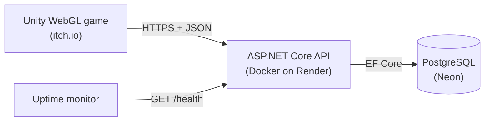

# Just Dodge + Player Game Data Service

A small Unity bullet-dodging game with its own backend: an ASP.NET Core API and a PostgreSQL database that power a live global leaderboard.

I built this project to learn backend development end to end: API design, databases, auth, Docker and deployment.

**Play it:** [choclified.itch.io/just-dodge](https://choclified.itch.io/just-dodge)

## How it works



1. After a run, the player types a name (3 to 5 characters) and submits their score.
2. On the first submit, the game registers the name and receives a secret token, which it stores locally.
3. Every score submit sends that token as a `Bearer` header, so nobody can post scores under someone else's name.
4. Each run gets a server-side run id when it starts, so the server can check that a score is possible for how long the run lasted.
5. The main menu shows the global top 10, with each player's best score only, and refreshes it automatically.

## Tech stack

| Part | Tech |
|---|---|
| Game | Unity 6, C#, UnityWebRequest, async/await |
| API | ASP.NET Core minimal APIs on .NET 10 |
| Database | PostgreSQL with Entity Framework Core (Npgsql) and migrations |
| Packaging | Docker (multi-stage build), Docker Compose |
| Hosting | Render (API), Neon (database), itch.io (game) |

## Features

- **Password-free identity:** players only pick a name. The server hands out a random 256-bit token and stores only its SHA-256 hash.
- **Leaderboards:** all-time top lists show one entry per player, with their best score.
- **Score verification:** the game starts a run on the server when gameplay begins. A score is only accepted for a known run, only once, and only if it's possible for the time that has passed.
- **Strict names:** 3 to 5 letters or digits, checked on the server, not just in the game.
- **Rate limiting:** 5 new names per hour and 20 runs or submits per minute per IP, using the real client IP behind the host's proxy.
- **Production ready:** migrations run on startup, secrets come from environment variables, `/health` endpoint, CORS limited to itch.io.

## Run it locally

You only need [Docker Desktop](https://www.docker.com/products/docker-desktop/).

```bash
git clone https://github.com/TwanPaemeleire/PlayerGameDataService.git
cd PlayerGameDataService
docker compose up --build
```

The API is now running on `http://localhost:5269`, with its own PostgreSQL database. Try `http://localhost:5269/scores/top`.

To play against it, open `game/JustDodge` in Unity 6 and assign the `ApiConfig_Local` asset to the `LeaderboardService` in the MainMenu scene.
